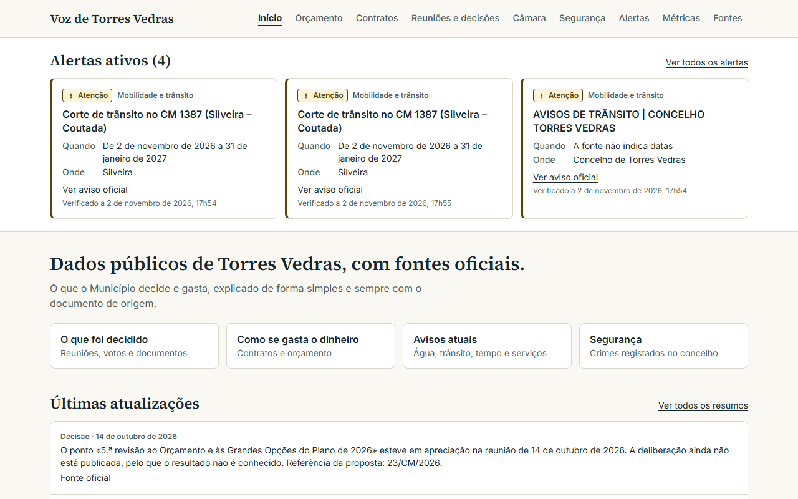
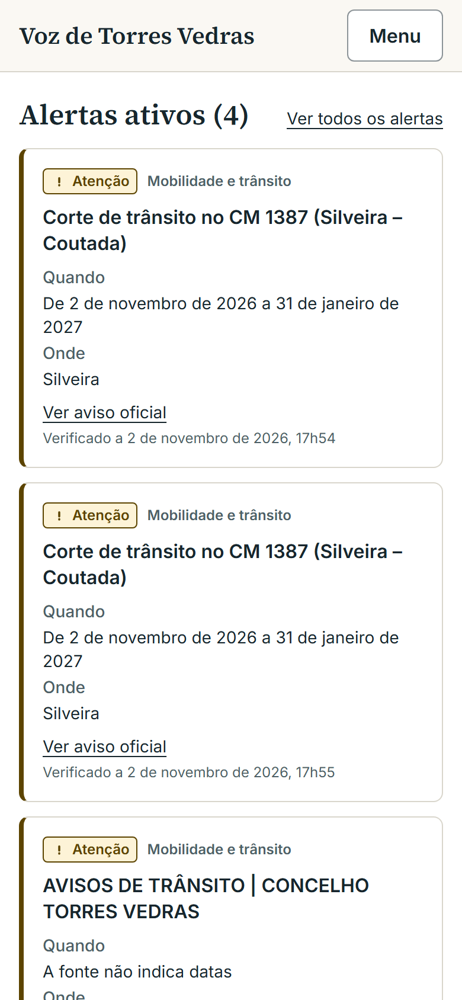
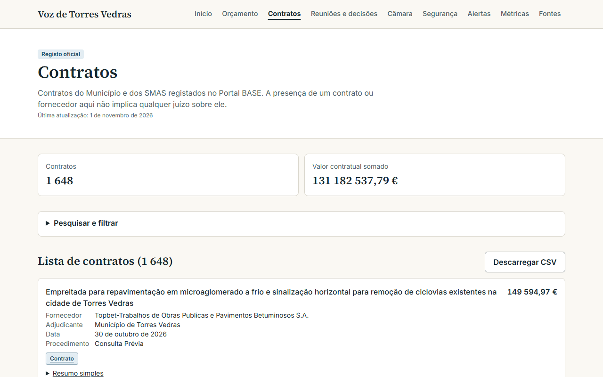

<div align="center">


# Voz de Torres Vedras

**Records · Data · Sources — Torres Vedras municipal transparency in one place.**

[](https://github.com/mwmiao/Voz-de-Torres-Vedras/actions/workflows/ci.yml)
[](https://hub.docker.com/r/eazyeight/voz-de-torres-vedras)

[🇵🇹 Português](README.md) · 🇺🇸 English



</div>

Voz de Torres Vedras is a public, read-only, self-hosted platform about the Municipality's activity. It gathers budget, contracts, meetings, decisions, elected officials, metrics, safety data and alerts, and every item links to its official source. No accounts, no sign-up, no email. The site itself is in Portuguese.

An independent project, not affiliated with the Municipality of Torres Vedras.

## Principles

- **No official source, no fact.** Anything without an official source is labelled "Not verified".
- **Record and context, always separate.** Editorial summaries are labelled as such.
- **Neutrality.** No accusations, no rating of people, no voting advice.
- **No estimates.** Data the source does not publish is shown as missing; approximate values say "about".

## Features

- **Active alerts** — official notices on traffic, water, weather and civil protection.
- **Meetings and decisions** — minutes, votes and documents of the Municipal Assembly and Executive, searchable.
- **Budget and contracts** — revenue, identified spending, public contracts, modifications and procedures, with filters.
- **Plain summaries** — rule-generated from official fields, no AI.
- **Safety** — map of incidents from the last 14 days with verification status always visible, plus yearly recorded crime (INE).
- **Sources and status** — every source, last update and errors at `/estado-das-fontes`.
- **Open data** — CSV export of decisions, contracts, meetings, budget, safety, alerts and metrics.

<div align="center">
  
  &nbsp;
  
</div>

> The platform shows public records and context — it is not advice or an official position of the Municipality.

## Install with Docker Compose

```yaml
services:
  app:
    image: docker.io/eazyeight/voz-de-torres-vedras:latest
    container_name: voz-de-torres-vedras
    pull_policy: always
    restart: unless-stopped
    ports:
      - "1400:1400"
    environment:
      APP_URL: http://localhost:1400
      PORT: "1400"
      UPDATE_INTERVAL_HOURS: "24"
    volumes:
      - ./data:/app/data
```

```bash
docker compose up -d
```

Open `http://<server-ip>:1400`. On first start the image creates `./data/voz-torres-vedras.db` and loads the bundled data snapshot. Keep the SQLite file on a local disk, not a network share.

| Variable | Default | Purpose |
|---|---|---|
| `APP_URL` | `http://localhost:1400` | Public address, used in the sitemap |
| `APP_PORT` | `1400` | Host port |
| `UPDATE_INTERVAL_HOURS` | `24` | How often sources are checked; 0 disables |
| `INGEST_DISABLED_SOURCES` | empty | Sources not to collect |

On low-memory machines use `INGEST_DISABLED_SOURCES=base-contratos`. To expose it to the Internet, put it behind an HTTPS proxy. Vercel and Netlify do not fit, since SQLite needs a persistent file.

## Security

Security headers, including a Content-Security-Policy, are in [next.config.ts](next.config.ts). The app is read-only and collects no personal data; names, addresses, plates and contacts are never published. Summary in [SECURITY.md](SECURITY.md).

## Technical documentation

See [docs/desenvolvimento.md](docs/desenvolvimento.md) (in Portuguese): database, backups, data ingestion and sources, collection rules, recent incidents and Docker Hub publishing.

## Development

```bash
cp .env.example .env
npm install
npm run db:deploy
npm run data:bootstrap
npm run dev     # http://localhost:1400
```

```bash
npm run typecheck && npm run lint && npm test
npm run build && npm run test:e2e
```

Every push to `main` that passes CI publishes `eazyeight/voz-de-torres-vedras:latest`. A `v1.2.3` tag also publishes `1.2.3`.

## License

Personal project by [@mwmiao](https://github.com/mwmiao). Built with Next.js, Tailwind CSS, Prisma and SQLite. License to be defined.
