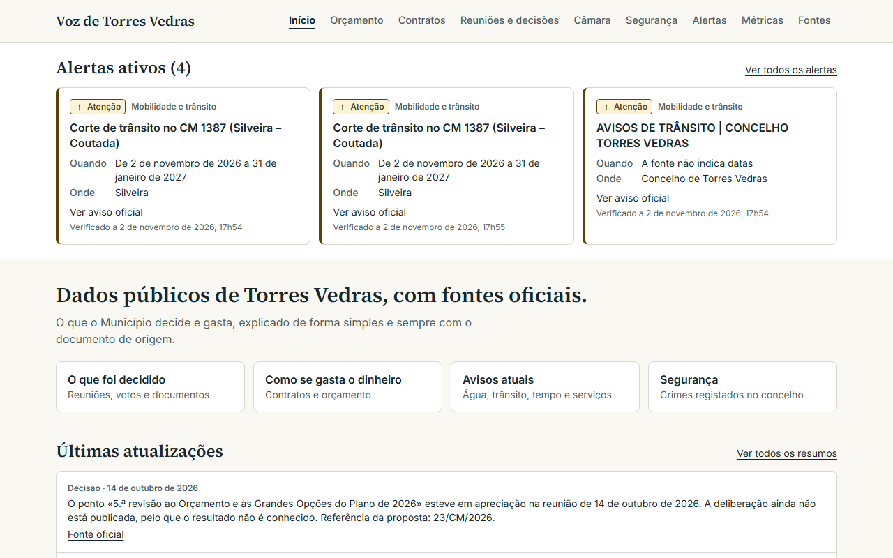
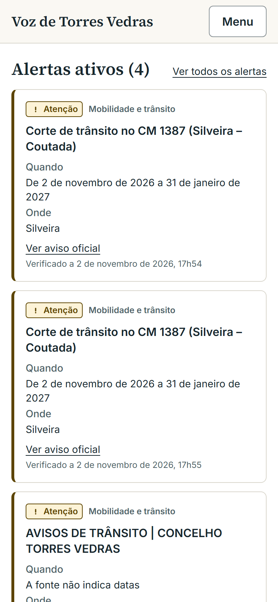
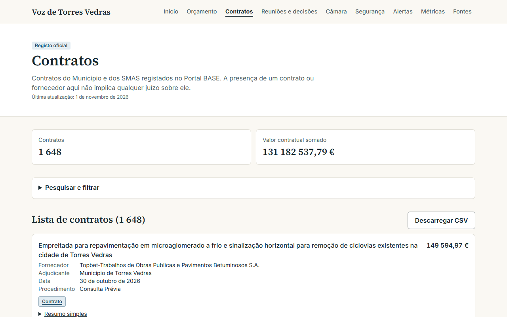

<div align="center">


# Voz de Torres Vedras

**Registos · Dados · Fontes — a transparência municipal de Torres Vedras, num só lugar.**

[](https://github.com/mwmiao/Voz-de-Torres-Vedras/actions/workflows/ci.yml)
[](https://hub.docker.com/r/eazyeight/voz-de-torres-vedras)

🇵🇹 Português · [🇺🇸 English](README.en-US.md)



</div>

O Voz de Torres Vedras é uma plataforma pública, só de leitura e self-hosted sobre a atividade do Município. Reúne orçamento, contratos, reuniões, decisões, eleitos, métricas, segurança e alertas, e cada informação liga à fonte oficial. Sem contas, sem registo e sem envio de email.

Projeto independente, sem ligação ao Município de Torres Vedras.

## Princípios

- **Sem fonte oficial, não é facto.** O que não tem fonte oficial fica como «Não verificado».
- **Registo e contexto, sempre separados.** Os resumos editoriais estão identificados como tal.
- **Neutralidade.** Sem acusações, classificações de pessoas ou recomendações de voto.
- **Sem estimativas.** Dados não publicados aparecem como tal; valores aproximados levam «cerca de».

## Funcionalidades

- **Alertas ativos** — avisos oficiais de trânsito, água, tempo e Proteção Civil.
- **Reuniões e decisões** — atas, votos e documentos da Assembleia Municipal e do Executivo, pesquisáveis.
- **Orçamento e contratos** — receita, despesa identificada, contratos públicos, modificações e procedimentos, com filtros.
- **Resumos simples** — gerados por regras a partir de campos oficiais, sem inteligência artificial.
- **Segurança** — mapa das ocorrências dos últimos 14 dias, com estado de verificação à vista, e crimes registados por ano (INE).
- **Fontes e estado** — todas as origens, última atualização e erros em `/estado-das-fontes`.
- **Dados abertos** — exportação CSV de decisões, contratos, reuniões, orçamento, segurança, alertas e métricas.

<div align="center">
  
  &nbsp;
  
</div>

> A plataforma mostra registos públicos e contexto — não é aconselhamento nem posição oficial do Município.

## Instalar com Docker Compose

```yaml
services:
  app:
    image: docker.io/eazyeight/voz-de-torres-vedras:latest
    container_name: voz-de-torres-vedras
    pull_policy: always
    restart: unless-stopped
    ports:
      - "1400:1400"
    environment:
      APP_URL: http://localhost:1400
      PORT: "1400"
      UPDATE_INTERVAL_HOURS: "24"
    volumes:
      - ./data:/app/data
```

```bash
docker compose up -d
```

Abre `http://<ip-do-servidor>:1400`. No primeiro arranque, a imagem cria `./data/voz-torres-vedras.db` e carrega a cópia de dados incluída. O ficheiro SQLite deve ficar num disco local, não numa pasta de rede.

| Variável | Valor por omissão | Função |
|---|---|---|
| `APP_URL` | `http://localhost:1400` | Endereço público, usado no mapa do site |
| `APP_PORT` | `1400` | Porta no anfitrião |
| `UPDATE_INTERVAL_HOURS` | `24` | Frequência das verificações; 0 desliga |
| `INGEST_DISABLED_SOURCES` | vazio | Origens a não recolher |

Em máquinas com pouca memória, usa `INGEST_DISABLED_SOURCES=base-contratos`. Para expor na Internet, usa um proxy com HTTPS. Vercel e Netlify não servem, porque o SQLite precisa de um ficheiro persistente.

## Páginas

| Página | Conteúdo |
|---|---|
| `/` | Alertas, últimas atualizações e números principais |
| `/orcamento` · `/contratos` | Orçamento e situação financeira; contratos públicos |
| `/reunioes` · `/resumos` | Decisões e reuniões; resumos simples |
| `/seguranca` · `/alertas` | Mapa e crimes por ano; avisos oficiais |
| `/metricas` · `/dossies` · `/camara` | Indicadores neutros; assuntos municipais; eleitos |
| `/fontes` · `/estado-das-fontes` | Todas as fontes; estado das recolhas |
| `/metodo` · `/privacidade` | Método e tratamento de dados |

## Segurança

Os cabeçalhos de segurança, incluindo uma Content-Security-Policy, estão em [next.config.ts](next.config.ts). A app é só de leitura e não recolhe dados pessoais. Nomes, moradas, matrículas e contactos nunca são publicados. Resumo em [SECURITY.md](SECURITY.md).

## Documentação técnica

Em [docs/desenvolvimento.md](docs/desenvolvimento.md): base de dados, backups, recolha de dados e origens, regras de recolha, ocorrências recentes e publicação no Docker Hub.

## Desenvolvimento

```bash
cp .env.example .env
npm install
npm run db:deploy
npm run data:bootstrap
npm run dev     # http://localhost:1400
```

```bash
npm run typecheck && npm run lint && npm test
npm run build && npm run test:e2e
```

Cada push para `main` que passa no CI publica `eazyeight/voz-de-torres-vedras:latest`. Uma etiqueta `v1.2.3` publica também `1.2.3`.

## Licença

Projeto pessoal de [@mwmiao](https://github.com/mwmiao). Feito com Next.js, Tailwind CSS, Prisma e SQLite. Licença por definir.
